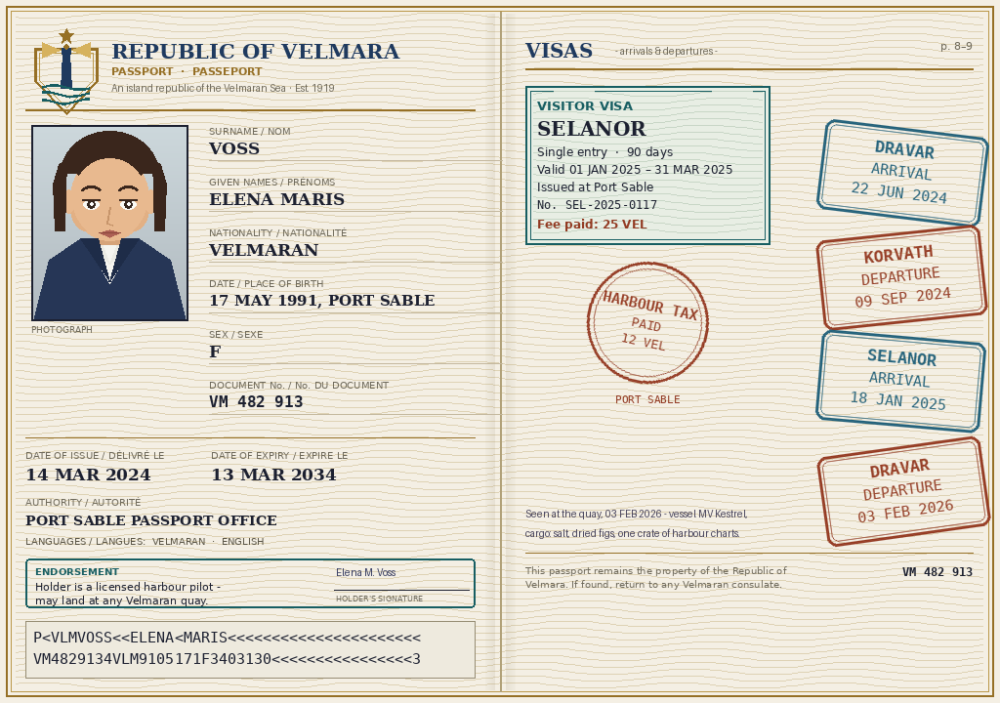

[](https://make.fun/bounty/the-passport-page-of-a-countr-2-20261121-0318?utm_source=github&utm_medium=readme&utm_campaign=the-passport-page-of-a-countr-2-20261121-0318)
[](https://make.fun/bounty/the-passport-page-of-a-countr-2-20261121-0318/leaderboard?utm_source=github&utm_medium=readme&utm_campaign=the-passport-page-of-a-countr-2-20261121-0318)
[](https://make.fun/bounty/the-passport-page-of-a-countr-2-20261121-0318?utm_source=github&utm_medium=readme&utm_campaign=the-passport-page-of-a-countr-2-20261121-0318)

# The Passport Page of a Country That Isn't There

Entry for the make.fun competition
`the-passport-page-of-a-countr-2-20261121-0318`.

`main.py` (Python 3.13, Pillow only, no network) draws one open passport
spread for the invented Republic of Velmara — a fictional island nation of
the Velmaran Sea — and writes it to `$MAKEFUN_OUTPUT_DIR/entry.png`
(default `/output/entry.png`).



## What's on the spread

- **Left page, the data page:** Velmara's coat of arms (lighthouse, star,
  three waves), a stylised portrait of the fictional holder Elena Maris
  Voss, personal data, the holder's signature, and a machine-readable zone
  with correctly computed ICAO check digits.
- **Right page, visas and stamps:** a Selanor visitor visa (single entry,
  90 days, fee paid 25 VEL), arrival and departure stamps from the
  neighbouring fictional states Dravar, Korvath and Selanor, and a circular
  "Harbour Tax Paid — 12 VEL" fee stamp from Port Sable.
- **The telling detail:** an endorsement recording that the holder is a
  licensed harbour pilot who may land at any Velmaran quay, plus a
  handwritten-style quay note — Velmara is a harbour country, and its
  paperwork shows it.

## Internal consistency

Every date agrees: the passport was issued 14 MAR 2024 and expires
13 MAR 2034; the Selanor visa runs 01 JAN – 31 MAR 2025 and its arrival
stamp is 18 JAN 2025; the last departure stamp (Dravar, 03 FEB 2026) is the
same day as the quay note about the vessel MV Kestrel. No stamp predates
the passport.

## Run it

```sh
pip install pillow
python3 main.py            # writes /output/entry.png
MAKEFUN_OUTPUT_DIR=out python3 main.py   # writes out/entry.png
```

The output is deterministic: two runs produce byte-identical PNGs
(1024 x 720, about 185 KB, within the 1 MiB / 1024 x 1024 limits).

## Fictionality

Every person, place, date, number and institution on the page is invented.
Nothing here copies a real country's passport, and no real person's data
appears anywhere in this repository.
